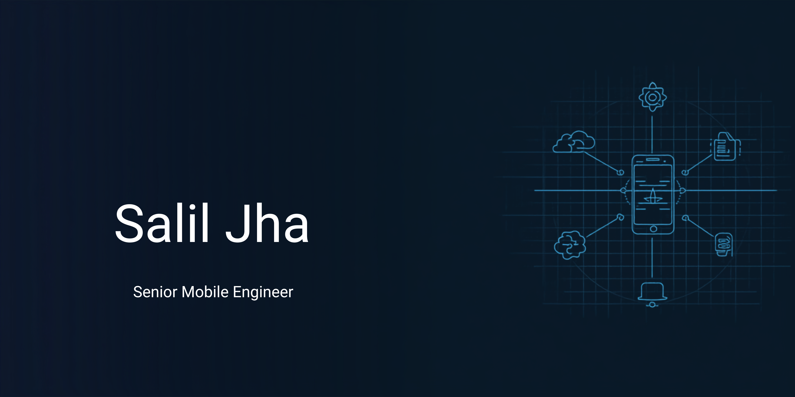

  

# Salil Samdarshy

## Senior Mobile Engineer | React Native · Android · Kotlin

My engineering focus is React Native and Android development, with experience represented in public and private project repositories. I also build the web services and product experiences that mobile applications depend on.

[LinkedIn](https://www.linkedin.com/in/saliljha1993/) ·
[Portfolio](https://salil1993.netlify.app) ·
[Email](mailto:saliljha1993@gmail.com)

## Featured products

### [Bharat Seva Setu](https://bharatsevasetu.com)

A local-services discovery platform for finding businesses, services, clinics, and professionals. The product includes a web experience and a consumer mobile REST API; it is presented here as a web platform, not as a native mobile app.

### [Bharat Swasthya Setu](https://bharatswasthyasetu.com)

A healthcare coordination platform for clinic and healthcare workflows. The repository is a PHP application with MySQL-related configuration and tests. Product capabilities and operational outcomes should be described only where verified.

## Technical focus

- React Native
- Android development with Java and Kotlin
- TypeScript and API-backed web applications
- PHP and MySQL

I am continuing to deepen my Kotlin and modern Android architecture skills, including Jetpack Compose.

## Engineering approach

I value clear module boundaries, maintainable code, thoughtful API integration, and testing that makes changes safer. My project work includes applications with domain modules, service and repository layers, API routes, and automated checks.

## Roles

Targeting Senior Mobile Engineer, Senior React Native Developer, and Android Developer roles across India — remote, hybrid, or onsite.
